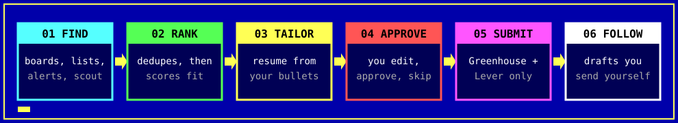

<div align="center">



<br>


**An internship search agent that runs in Claude Code on your own computer.**<br>
It finds postings, tailors a one-page resume for each job, prepares the application,<br>and waits for your approval before anything is sent.

**[`INSTALL`](#-01--install)** · **[`USE`](#-02--daily-use)** · **[`RULES`](#-03--hard-rules)** · **[`DATA`](#-04--your-data)** · **[`STATUS`](#-05--status)** · **[`FIX`](#-06--troubleshooting)**

</div>



```text
SOURCES   job boards · GitHub lists · alert emails · scout agent
   ↓
TRACKER   removes duplicates, filters, scores fit
   ↓
PREPARE   tailored resume + drafted form answers
   ↓
APPROVE   you edit, approve or skip on a local dashboard
   ↓
SUBMIT    Greenhouse and Lever go out from your browser. Other sites, you press Submit.
   ↓
FOLLOW    outreach drafts you rewrite and send yourself
```

## ▓ 01 // INSTALL

You need a Mac or Linux computer and a paid Claude plan.

**1. Install [Claude Code](https://docs.claude.com/en/docs/claude-code/overview).**

**2. Download this repo and run the setup script.** It checks for Python and the resume tools, and asks before installing anything.

```bash
git clone https://github.com/carloxaugustine/archangel.git
cd archangel
./setup.sh
```

**3. Put your resumes in the `inbox/` folder.** Include old versions, cover letters and project write-ups if you have them. If you have no resume, that's fine: the interview builds one from your answers.

**Optional, and worth it:** if you've used ChatGPT, Claude or another assistant for school or projects, paste the prompt from [`prompts/ai-context-export.md`](prompts/ai-context-export.md) into those chats and save each answer in `inbox/`. It recovers project details and numbers that never reached your resume. Setup asks you to confirm each one before using it, because AI memory can be wrong.

**4. Start the guided setup.**

```bash
claude
```

Then type `/internship-setup`. It reads your documents, asks about what's missing, builds a test resume, and tunes the search to your field. Allow 15 to 30 minutes.

## ▓ 02 // DAILY USE

| Do this | To |
|---|---|
| `/internship-agent` in Claude Code | find jobs and prepare applications, or fill the ones you approved |
| `./dashboard/serve.py` in a terminal | review and approve cards at http://127.0.0.1:8377 |
| `./install_schedule.sh 06:45` | run it every morning automatically (optional) |
| `./run_scout.sh` | search for newer, less competitive postings |

To fill forms, install the Claude in Chrome extension and start with `claude --chrome`. To track confirmations and replies, connect Gmail under Connectors in your claude.ai settings.

## ▓ 03 // HARD RULES

```diff
+ ALLOW  fill forms from your profile and answers you approved
+ ALLOW  build resumes from bullets in your own bank
+ ALLOW  submit Greenhouse and Lever applications you approved

! HOLD   new installs start in dry-run mode and stop before Submit
! HOLD   Workday and other sites: it fills after you sign in, you press Submit
! HOLD   terms and truthfulness checkboxes stay yours

- DENY   inventing a fact, a number or a skill
- DENY   sending anything without your approval
- DENY   automating LinkedIn, solving CAPTCHAs or entering passwords
- DENY   messaging anyone: outreach is drafts only
```

Set `dry_run = false` in `config.toml` when you trust it.

## ▓ 04 // YOUR DATA

Your profile, resumes, applications and tracker stay in this folder, and `.gitignore` keeps them out of git. The dashboard runs only on your computer. Claude processes what you give it under your own Claude account, and job sites receive what you submit.

Before pushing a fork, run `git status` and confirm no personal files are listed.

## ▓ 05 // STATUS

This is new. It came out of one person's real search and has had one round of testing as a template.

```diff
+ TESTED    clean install, resume builder, job fetching, approval flow, dashboard
+ TESTED    setup interview, run automatically on a made-up student
! NOT YET   setup with a real person answering the questions
! NOT YET   form filling, Gmail sync and scheduling in this version
! NOT YET   Linux
```

Check the first few applications closely, and open an issue when something breaks.

**Also worth knowing:**

- You're responsible for everything submitted in your name. Read each application, especially questions about work authorization or legal status.
- Some job sites restrict automated applications. Check the rules of the sites you use and decide for yourself.
- The starter company list leans toward aerospace, defense and hardware. Setup trims it for your field, but other fields will need more boards added.
- Applications alone rarely do it. Outreach to real people usually matters more.

## ▓ 06 // TROUBLESHOOTING

<details>
<summary><b>Open the fault table</b></summary>

<br>

| Problem | Try |
|---|---|
| `/internship-setup` not found | Run `claude` from inside this folder |
| Resume won't build | Run `./resume-builder/build_resume.py <spec>` and read the message; it names the bullet or rule |
| No jobs, or the wrong jobs | Ask Claude to adjust `[scoring]` and `[[company]]` in `config.toml` for your field |
| A company is missing | `./probe_boards.py companyname` finds its board, then add it to `config.toml` |
| Browser tools unavailable | Start with `claude --chrome` and check the extension is on |

</details>

<br>

<div align="center">

`MIT LICENSE` · `RESUME TEMPLATE BY JAKE GUTIERREZ` · `NAMED FOR LOCKHEED'S ARCHANGEL DESIGN SERIES, WHICH LED TO THE A-12`

</div>
